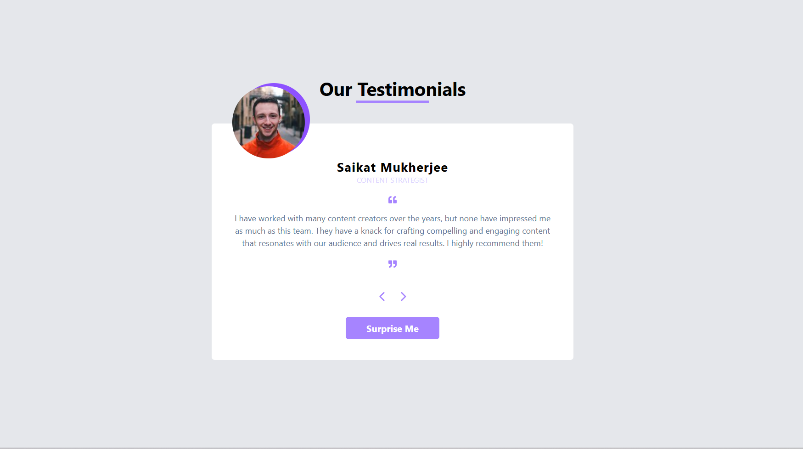

# 💬 React Testimonials

A responsive React application that showcases user testimonials through an interactive card interface. The project demonstrates state management using React Hooks, reusable components, and dynamic navigation with a clean and modern user experience.

---

## ✨ Features

- 👤 Display user testimonials
- ⬅️ Browse previous testimonial
- ➡️ Browse next testimonial
- 🎲 Surprise Me (Random Testimonial)
- ⚡ Dynamic UI updates using React Hooks
- 📱 Responsive and clean user interface

---

## 🛠️ Tech Stack

- ⚛️ React
- 🟨 JavaScript (ES6+)
- 🎨 CSS3
- ⚡ Vite
- 🌿 Git & GitHub

---

## 🌐 Live Demo

🔗 **Coming Soon**

> The project will be deployed on Vercel.

---

## 📂 Project Structure

```text
src/
├── assets/
├── components/
│   ├── Card.jsx
│   └── Testimonials.jsx
├── data.jsx
├── App.jsx
├── App.css
├── index.css
└── main.jsx
```

---

## 📸 Project Screenshot



---

## 🚀 Getting Started

### Clone the repository

```bash
git clone https://github.com/Arsh173/react-testimonials.git
```

### Navigate to the project folder

```bash
cd react-testimonials
```

### Install dependencies

```bash
npm install
```

### Start the development server

```bash
npm run dev
```

---

## 📚 React Concepts Practiced

- Functional Components
- Props
- useState Hook
- Event Handling
- Conditional Rendering
- Component Composition
- Dynamic Data Rendering

---

## 🎯 Future Improvements

- ⭐ Rating System
- ❤️ Like Testimonials
- ➕ Add New Testimonials
- 🔍 Search Testimonials
- 🌙 Dark Mode
- 💾 Backend Integration

---

## 👨‍💻 Author

**Arsh**

- GitHub: https://github.com/Arsh173
- LinkedIn: https://linkedin.com/in/arsh0786

---

## ⭐ Support

If you found this project helpful, consider giving it a ⭐ on GitHub!